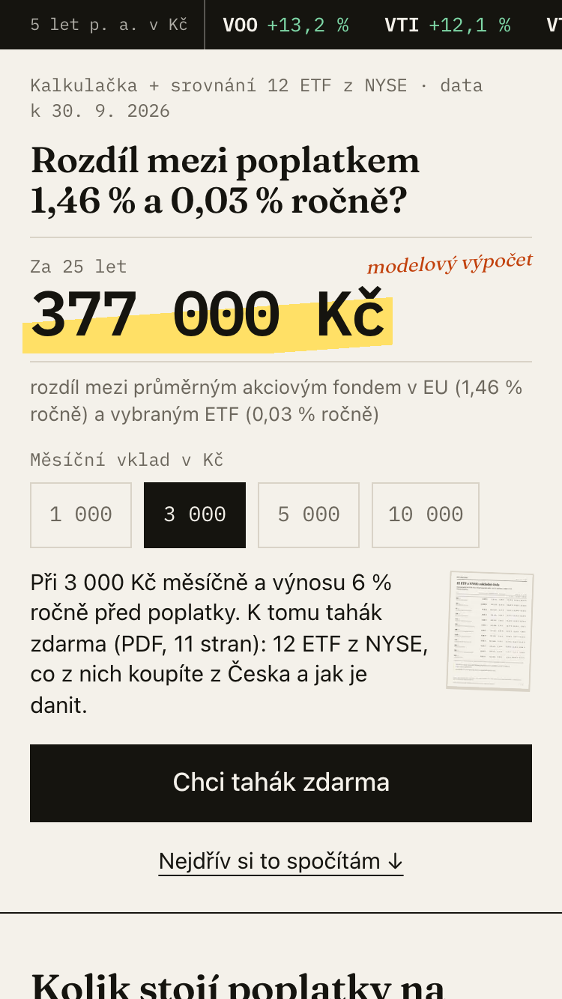
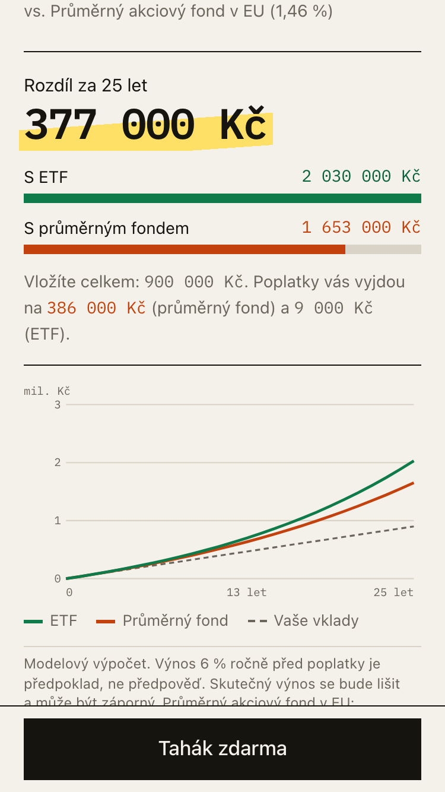
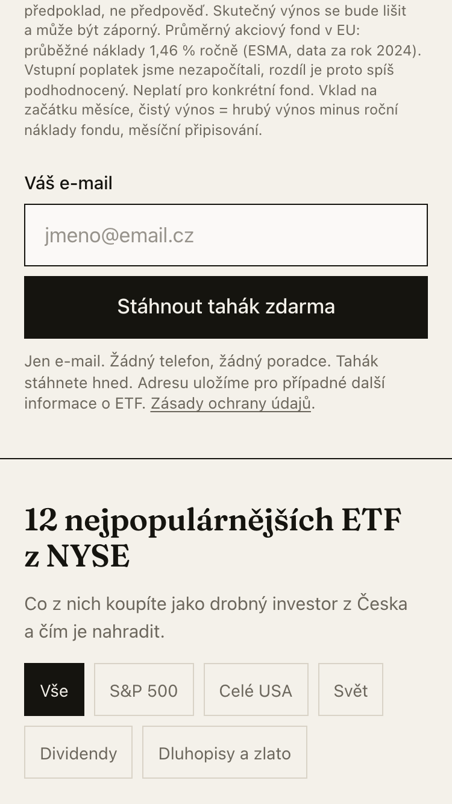
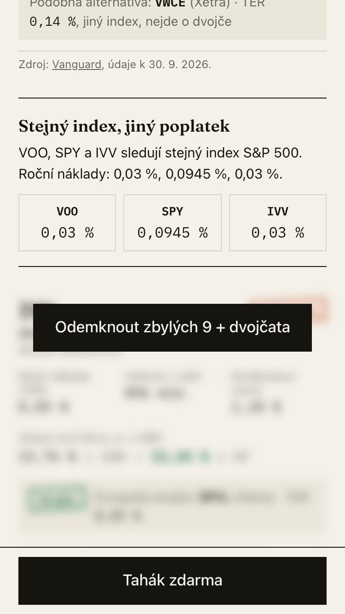
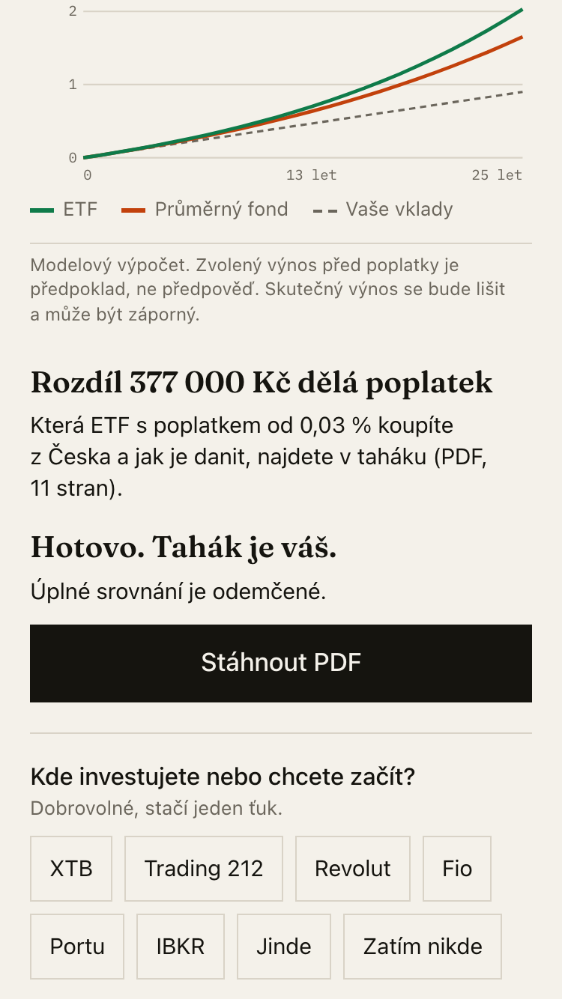
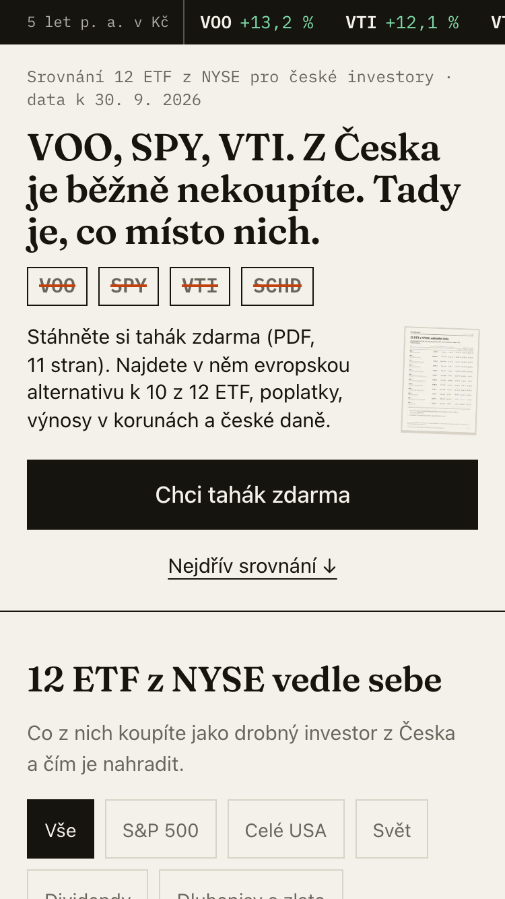
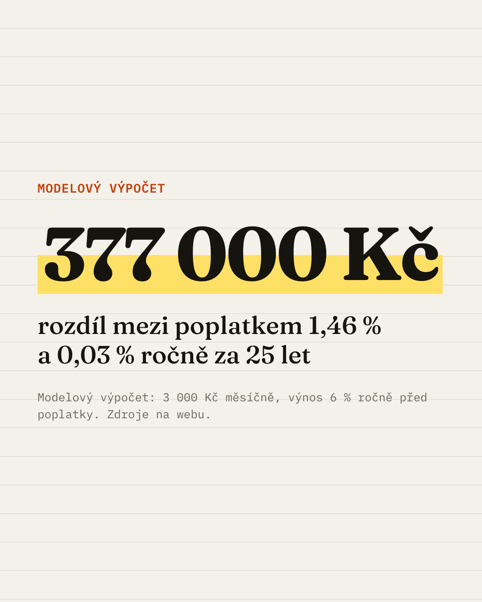
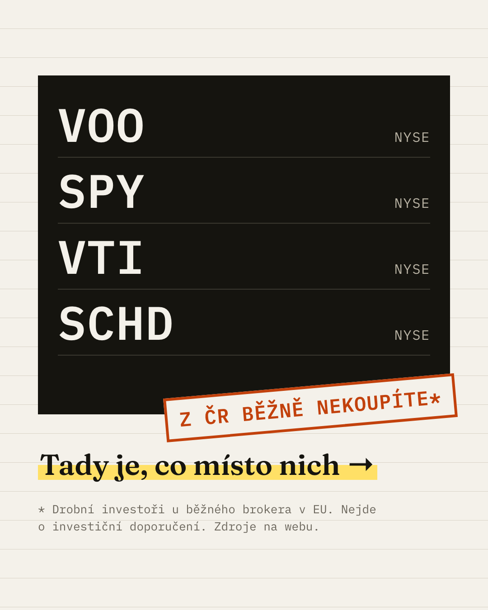

# ETF tahák

Konverzní landing page (lead magnet) se srovnáním 12 ETF z NYSE pro české drobné investory, kteří přicházejí z mobilní reklamy na Instagramu a Facebooku.

| | |
|---|---|
| Produkce | https://etf-tahak.vercel.app (varianta A `/poplatky`, varianta B `/srovnani` = `/`) |
| Reklamy | [`ads/A-poplatky/`](ads/A-poplatky/copy.md), [`ads/B-voo/`](ads/B-voo/copy.md): texty, kreativy 4:5 a 9:16, UTM, cílení |
| Lead magnet | [PDF tahák, 11 stran, 483 kB](public/tahak/c616ae54ee.pdf), generovaný ze stejných dat jako web |
| Lighthouse mobil (produkce) | výkon 99, přístupnost 100, best practices 100, SEO 100. LCP 1,4 až 2,0 s, CLS ≈ 0 |
| AI log | [`ai-log/`](ai-log/): exporty chatů s Claude Code |

<p>






</p>

Průchod na 375 px z produkce: hero A → výsledek kalkulačky → formulář pod ním → gate ve srovnání → děkovný stav → hero B. Generuje `node scripts/walkthrough.mjs`.

## 1. Rozhodnutí v kostce

1. **Pro koho:** začínající český investor 24 až 40 let, který z YouTube zná „VOO“, ale neví, co si z toho koupí, kolik ho to bude stát a jak to danit.
2. **Co dostane:** PDF „ETF tahák 2026“ (12 ETF, evropská dvojčata, daně v ČR, checklist) a odemčené kompletní srovnání přímo na stránce. Hned, bez čekání na e-mail.
3. **Kdy žádáme kontakt:** až po první hodnotě. Hlavní místo je pod výsledkem kalkulačky. Výsledek ani 3 karty ETF za e-mailem nejsou.
4. **Formulář:** jediné pole, e-mail. Bez jména, telefonu, checkboxu i CAPTCHA.
5. **Měření:** PostHog EU (do souhlasu bez cookies) + serverová událost `lead_created` + UTM, varianta a „cesta“ uložené u každého leadu v DB. Pravdivý počet leadů je v DB, i když někdo blokuje tracking.

## 2. Cílová skupina a insight

- **Persona:** zaměstnanec nebo OSVČ, 24 až 40 let, 50 až 500 tis. Kč na spořáku nebo v bankovním fondu. Má nebo zakládá účet u XTB, Trading 212, Revolutu, Fio, Portu nebo IBKR.
- **Kontext návštěvy:** mobil, in-app prohlížeč IG/FB, večer. Do 3 až 8 s se rozhodne, jestli zůstane.
- **Job to be done:** „Chci si vybrat 1 až 2 ETF a začít pravidelně investovat, aniž bych udělal drahou chybu.“
- **Insight:** srovnání ETF z NYSE jsou psaná pro Američany. Čech řeší tři jiné věci, na kterých stojí stránka i obě reklamy:
  1. americké ETF jako retailový klient v EU obvykle nekoupí (PRIIPs, chybí KID),
  2. výnos v korunách není výnos v dolarech (kurz ČNB),
  3. platí české daně (časový test 3 roky, limit 100 000 Kč).
- **Koho necílíme:** pokročilé investory, tradery a lovce rychlého zbohatnutí.

## 3. Nabídka, hodnota před formulářem a moment žádosti

| Před formulářem (zdarma) | Za e-mail |
|---|---|
| výsledek kalkulačky hned s výchozími hodnotami | PDF tahák (stažení hned) |
| 3 plné karty ETF (VOO, SPY, VT) i s dvojčaty | odemčení zbylých 9 ETF a dvojčat bez reloadu |
| „3 věci, které vám americká videa neřeknou“ s čísly | (s doménou) výpočet a odkaz e-mailem |
| náhled 3 skutečných stran taháku | |

**Místa výzvy** (vždy stejná komponenta `LeadForm`, liší se `location`):

| # | Místo | Spouštěč | Role |
|---|---|---|---|
| 1 | pod výsledkem kalkulačky | návštěvník vidí svoje číslo | hlavní, vrchol motivace |
| 2 | gate ve srovnání | ťuk na „Odemknout zbylých 9 + dvojčata“ | zvědavost |
| 3 | hero CTA | rozhodnutí hned → bottom sheet | opt-in ve 2 krocích |
| 4 | lepivá lišta | po odrolování hero, schová se u formuláře, s klávesnicí a po odeslání | záchytná síť |
| 5 | „Co je v taháku“ + závěr | po náhledu stran a FAQ | pro váhavé |

Žádný popup ani exit-intent. Po odeslání se všechna místa přepnou do stavu „hotovo“.

## 4. Reklamy A/B a návaznost první obrazovky

| | A „Poplatky“ → `/poplatky` | B „VOO z Česka nekoupíte“ → `/srovnani` |
|---|---|---|
| Úhel | averze ke ztrátě | zvědavost, insider |
| Kreativa |  |  |
| Slib | „377 000 Kč“: rozdíl mezi poplatkem 1,46 % a 0,03 % ročně za 25 let (modelový výpočet) | tickery VOO · SPY · VTI · SCHD přeškrtnuté, „z ČR běžně nekoupíte“, „Tady je, co místo nich“ |
| Hero na webu | stejné číslo a věta, volba měsíční částky přímo v hero | stejná tabule tickerů a věta, pod ní srovnání |

- **Čísla jsou na jednom místě:** reklama, hero, výchozí kalkulačka i OG obrázek berou hodnoty ze `src/data/examples.json`. Hlídá to test `ads/ads.test.ts`.
- **Kreativy:** generuje je kód (HTML → PNG přes Playwright, `npm run ads`). Mají stejné tokeny a fonty jako web. Stories mají horních a dolních 270 px bez textu.
- **Zásady Mety:** reklamy netvrdí osobní vlastnosti adresáta a neslibují výnos, výpočet označují jako „modelový“. Special Ad Category „Financial products and services“ je podle [dokumentace Mety](https://developers.facebook.com/docs/marketing-api/audiences/special-ad-category) povinná pro USA. V Evropě platí jen u úvěrů, pro CZ kampaň tedy povinná není (ověřeno 14. 10. 2026).

## 5. Pořadí sekcí a proč

Pořadí je konfigurace podle varianty (`src/content/variants.ts`).

| # | A `/poplatky` | B `/srovnani` | Proč právě tady |
|---|---|---|---|
| S1 | Hero: číslo + volba částky | Hero: tabule tickerů | do 3 s potvrdit slib reklamy (message match). CTA se vejde do 360×600, protože in-app prohlížeč ukrojí lištu |
| S2 | Kalkulačka + formulář #1 | Srovnání + gate #2 | první hodnota co nejdřív: na mobilu většina lidí uvidí 1 až 2 obrazovky. Každá varianta začíná tím, co slíbila reklama |
| S3 | Srovnání + gate #2 | Kalkulačka + formulář #1 | druhá hodnota a druhý důvod nechat e-mail |
| S4 | 3 věci, které vám americká videa neřeknou | ← | prohlubuje mezeru ve znalostech, kterou zaplní tahák |
| S5 | Co je v taháku: náhled 3 stran + formulář #5 | ← | nabídka je nejkonkrétnější těsně před výzvou |
| S6 | Kdo za tím stojí, odkud jsou data, FAQ | ← | námitky („Zavolá mi někdo?“, „Je to doporučení?“) řešíme až u váhajících |
| S7 | Závěrečné CTA + patička se zdroji a upozorněním | ← | poslední šance a compliance |

Žádná navigace ani odkazy ven (kromě zdrojů v novém okně).

## 6. Interaktivní prvky → kontakt

- **Kalkulačka poplatků:** měsíční vklad (čipy + vlastní částka), horizont 10 až 30 let, předpokládaný výnos 4/6/8 % se štítkem „předpoklad, ne předpověď“, výběr UCITS ETF vs. průměrný akciový fond v EU (ESMA). Přepočítá se hned, s vlastním SVG grafem. Pod výsledkem je formulář #1 a výpočet se uloží k leadu.
- **Srovnávač 12 ETF z NYSE:** karty s filtry, TER, velikostí, dividendou, výnosem za 5 let v USD i v Kč a evropským dvojčetem. 3 karty zdarma, zbytek rozmazaný za gate #2. Po odeslání se odemknou bez reloadu.
- **Oprava překlepů v doméně** pro české schránky („Mysleli jste @seznam.cz?“), oprava jedním ťukem.

## 7. Co se stane po odeslání

1. **Okamžitě (optimisticky):** „Hotovo. Tahák je váš.“, tlačítko **Stáhnout PDF** a odemčené srovnání. Když selže server, PDF návštěvník dostane i tak a chybu jen zalogujeme.
2. **Jedna dobrovolná otázka na 1 ťuk:** „Kde investujete nebo chcete začít?“ Odpověď se uloží k leadu pro kvalifikaci.
3. **Sdílení** přes Web Share API (fallback kopírování odkazu) s `utm_source=share`.
4. **E-mail** (Resend) je hotový a otestovaný ([náhled](docs/img/email-preview.png)), ale v produkci je vypnutý přepínačem `NEXT_PUBLIC_EMAIL_ENABLED=false`, dokud nebude vlastní doména. Bez domény Resend doručí jen na adresu vlastníka účtu. Texty proto e-mail neslibují.
5. **Navazující sekvence (návrh):** D+2 daně krok za krokem, D+4 tři drahé chyby začátečníků, D+7 jak koupit UCITS ETF u brokera, D+10 nabídka zadavatele.

## 8. Data a zdroje

Každé číslo má `source` (URL) a `as_of`. Bez nich build dat ani testy neprojdou. Na stránce je datum dat v hero, zdroj u každé karty a sekce a úplný seznam v patičce. **Data jsou k 30. 9. 2026.**

| Údaj | Zdroj |
|---|---|
| TER, velikost, dividenda, výnosy NAV 1/5/10 let | stránky a fact sheety emitentů: Vanguard, iShares, State Street (SPDR), Schwab |
| UCITS dvojčata (ticker, ISIN, TER, domicil) | stránky emitentů, justETF jen jako kontrola |
| Kurz USD/CZK | denní kurz ČNB, výnos v Kč = (1 + r_USD)ⁿ × FX_konec / FX_začátek, pak anualizace |
| „Americké ETF retail v EU nekoupí“ | nařízení (EU) 1286/2014 (PRIIPs) na EUR-Lex + FAQ Interactive Brokers |
| Náklady průměrného akciového fondu (1,46 %) | ESMA, Costs and Performance of EU Retail Investment Products 2026 (data 2024) |
| Daně | zákon č. 586/1992 Sb. (zakonyprolidi.cz), Finanční správa, IRS (W-8BEN, smlouva o dvojím zdanění) |
| Předpoklad výnosu 6 % | modelový předpoklad, odkaz na UBS Global Investment Returns Yearbook |

**Neověřené (`verified: false`, na webu označené hvězdičkou):** dividendový výnos VWO (tabulka emitenta má jen 5 výplat za 12 měsíců) a SPY (stránka neuvádí datum výpočtu). Stav Retail Investment Strategy na EUR-Lex.

**Aktualizace dat:**

```bash
cd data && uv run python build.py
```

Pak `npm run pdf` (tahák a náhledy), `npm run ads` (kreativy) a `npm run og` (OG obrázky) a commitnout výstupy.

## 9. Měření

**Funnel (PostHog EU, dashboard „ETF tahák“):** `landing_viewed` → `form_viewed` → `form_started` → `lead_created` (serverová událost), okno 1 den, breakdown `variant`, pak `utm_content`, `location` a `in_app_browser`.

- **Události** (úplný seznam v [`docs/PLAN.md` §12](docs/PLAN.md)): `landing_viewed`, `section_viewed`, `scroll_depth`, `cta_clicked`, `calc_interacted`, `calc_changed`, `compare_filter_changed`, `compare_gate_clicked`, `form_viewed`, `form_started`, `form_error`, `email_typo_suggested/accepted`, `form_submitted`, `lead_created`, `thankyou_viewed`, `pdf_downloaded`, `profile_answered`, `share_clicked`, `consent_updated`, `web_vitals`. Všechny jdou přes jediný modul `src/lib/track.ts`.
- **Společné vlastnosti:** `variant`, `utm_*`, `in_app_browser` (FB/IG/TikTok z User-Agentu), `viewport_w`, `ms_since_landing`.
- **Souhlas:** do volby běží PostHog bez cookies (`persistence: memory`). Meta Pixel se načte až po souhlasu a jen s ID v env.
- **DB:** u každého leadu je UTM (first touch), varianta, místo formuláře, snapshot kalkulačky a `journey` (čas do odeslání, viděné sekce, použití kalkulačky, klik na gate). SQL pro konverzi a CPL podle reklamy je v [`analytics/funnel.sql`](analytics/funnel.sql).
- **Mezi reklamou a webem:** „link clicks“ v Metě proti `landing_viewed` ukážou, kolik lidí odpadne při načítání v in-app prohlížeči.
- **Testovací provoz** má `utm_source=claude_test` a PostHog ho filtruje. Funnel je proto do spuštění reklamy prázdný.

## 10. Očekávaná konverze

**Metrika:** leady / unikátní `landing_viewed`.

| Krok | Na 100 návštěv | Předpoklad |
|---|---|---|
| Landing viewed | 100 | |
| Engaged (scroll za hero nebo interakce) | 55 | studený mobilní provoz, slib sedí s reklamou |
| Interakce s kalkulačkou nebo srovnáním | 30 | interakce už v první obrazovce |
| Viděl formulář s úmyslem | 18 | formulář je hned pod výsledkem |
| Začal psát | 12 | 1 pole, autocomplete |
| Odeslal | 9 | ~75 % dokončení u formuláře s 1 polem |

**Odhad: 9 % (pesimisticky 5 %, optimisticky 14 %).**

**Kotvy** ([Unbounce Conversion Benchmark Report 2024](https://unbounce.com/conversion-benchmark-report/), 41 000+ landing pages, 57 mil. konverzí; [rozpad pro finance](https://unbounce.com/conversion-benchmark-report/finance-insurance-conversion-rate)):

| Segment | Medián konverze |
|---|---|
| všechna odvětví | 6,6 % |
| finanční služby | 8,3 % |
| investování (podkategorie) | 3,9 % |
| finance, placené sociální sítě (Facebook / Instagram) | 9,3 % (10,1 % / 15,5 %) |
| finance, mobil | 11,5 % |

Investiční stránky Unbounce jsou často poptávky po poradci s více poli. My máme lead magnet s jedním polem a hodnotou předem, což nás táhne nahoru. Dolů nás táhne studený provoz ze sociálních sítí. Proto odhad 9 % leží mezi investováním (3,9 %) a finančním paid social (9,3 %).

**CPL (ilustrativně):** CPC 10 až 15 Kč, 80 % kliků se skutečně načte → CPL ≈ 12 / (0,8 × 0,09) ≈ **170 Kč** (rozpětí ~110 až 300 Kč pro konverzi 14 až 5 %).

## 11. Tři A/B hypotézy podle očekávaného dopadu

Velikost vzorku počítá [`analytics/sample_size.py`](analytics/sample_size.py) (statsmodels, oboustranný test, α = 0,05, síla 0,8, základ 9 %): `uv run analytics/sample_size.py`.

| # | Hypotéza | Varianty | Očekávání | Primární metrika | n na variantu |
|---|---|---|---|---|---|
| 1 | **Hloubka gate.** Protože zvědavost na zbylých 9 ETF je druhý nejsilnější spouštěč, zamčení zvýší počet leadů. | karty 4 až 12 a dvojčata zamčené vs. vše zdarma, za e-mail jen PDF | +30 až 50 % leadů. Riziko: horší kvalita, proto sledujeme i stažení PDF a odpověď na otázku | `lead_created` / `landing_viewed` | ~2 000 (při +30 %) |
| 2 | **Interaktivní vs. statický hero.** Protože číslo, které reaguje na ťuk, dovede víc lidí k prvnímu „aha“. | volba částky a živé číslo v hero vs. jen text a CTA | +15 až 25 % | konverze landing page | ~7 500 (při +15 %) |
| 3 | **Formulace CTA.** Protože osobní nabídka v 1. osobě zní jako služba, ne jako marketing. | „Pošlete mi můj výpočet“ vs. „Chci tahák zdarma“ | +5 až 15 % | `form_started` → `lead_created` | ~65 000 (při +5 %), ~7 500 (při +15 %) |

H3 je při testovacím rozpočtu (5 000 Kč ≈ 330 kliků na variantu) neprůkazná, dává smysl až při větším provozu. **Backlog:** tykání vs. vykání, skutečné počítadlo stažení, lepivá lišta ano/ne, pořadí kalkulačky a srovnání. Test úhlů reklam A vs. B běží od spuštění, není to hypotéza pro landing page.

## 12. Launch checklist

**Hotovo a ověřeno na produkci (14. 10. 2026):**

- [x] Lighthouse mobil `/poplatky` i `/srovnani`: 99 / 100 / 100 / 100, LCP 1,4 až 2,0 s, CLS ≈ 0.
- [x] Playwright 320 / 360 / 375 / 414 px a na šířku, bez vodorovného posunu. Hero s CTA se vejde do 360×600. Sheet a lepivá lišta s otevřenou klávesnicí.
- [x] V konzoli nejsou chyby. OG obrázky pro obě reklamy, favicon, apple-icon, vlastní 404.
- [x] Klíče nejsou v repu, v historii ani v `ai-log/` (kontrola hodnot z `.env.local` proti `git log -p`). Service key není v klientském bundlu (`scripts/check-bundle.mjs`).
- [x] Rate limit na `POST /api/lead*` ve Vercel Firewall: 10 požadavků za minutu z jedné IP, pak 5 min blok. Formulář při blokaci PDF vydá i tak.
- [x] Bezpečnostní hlavičky (`nosniff`, `X-Frame-Options`, `Referrer-Policy`, `Permissions-Policy`). RLS zapnuté bez veřejných policies, zapisuje jen service role.
- [x] Supabase free projekt se nepozastaví: Vercel Cron denně volá `/api/keepalive`.

**Ruční test v in-app prohlížeči** (odkaz s UTM v DM). Instagram na iPhonu prošel 14. 10. 2026 celý. Lead se uložil s `in_app_browser = instagram` a `utm_content = ig_test`. Jediný nález (natlačená tabulka na straně 2 PDF) je opravený. Před spuštěním zopakovat na Androidu a ve Facebooku/Messengeru:

- [x] Stránka se načte do ~2 s, hero i tlačítko „Chci tahák zdarma“ jsou vidět bez posunu.
- [x] Číslo v hero sedí s reklamou (377 000 Kč / tickery). Volba částky v hero přepočítá číslo.
- [x] Ťuk na hero CTA otevře sheet a vyjede klávesnice. Pole i tlačítko jsou nad klávesnicí, nic je nezakrývá.
- [x] Klávesnice nabízí `@` a „Odeslat“ (typ e-mail), automatické velké písmeno je vypnuté.
- [x] Překlep `jan@seznam.cy` nabídne opravu na `@seznam.cz`.
- [x] Odeslání: děkovný stav, srovnání se odemkne, lepivá lišta zmizí.
- [x] **Stáhnout PDF** v in-app prohlížeči PDF otevře (IG ho může otevřít v náhledu, to je v pořádku). Pokud nejde, zapsat a nahlásit.
- [x] Lepivá lišta se při odrolování ukáže a nezakrývá lištu cookies ani formulář.
- [x] Lišta cookies: „Odmítnout“ a „Přijmout“ fungují a po reloadu se neukáže znovu.
- [ ] Na šířku: obsah se nerozpadne a vodorovně se neposouvá.
- [x] Lead se objeví v Supabase s `in_app_browser = instagram/facebook` a správným `utm_content`. Testovací leady pak smazat.

**Před spuštěním reklamy zbývá (na provozovateli):**

- [ ] Doplnit provozovatele v patičce a v zásadách (teď placeholder).
- [ ] Ověřit, že název „ETF tahák“ ani doména nejsou obsazené. Ideálně koupit doménu.
- [ ] S doménou: ověřit ji v Resend (SPF, DKIM), nastavit `NEXT_PUBLIC_EMAIL_ENABLED=true` a `EMAIL_FROM`.
- [ ] Meta Business: Pixel ID do `NEXT_PUBLIC_META_PIXEL_ID`, ověřená doména, konverze Lead.
- [ ] Samostatný souhlas pro propagaci produktů zadavatele (zákon č. 480/2004 Sb.), pokud se mají posílat.
- [ ] Před spuštěním ověřit na EUR-Lex stav Retail Investment Strategy (změny PRIIPs).

## 13. Technika

- **Stack:** Next.js 16 (App Router, TypeScript, Tailwind 4) na Vercelu, Supabase (EU, Frankfurt) pro leady, Resend pro e-mail, PostHog EU. Data v Pythonu (`uv`, `ruff`, `pydantic`).
- **Vědomá výjimka z „API = FastAPI“:** jediný endpoint pro formulář je Next.js route handler. FastAPI na free tieru se po nečinnosti probouzí desítky sekund, takže by se ztrácely leady z placené reklamy.
- **Výkon:** LCP prvek je text (žádný hero obrázek). Kritické CSS je inline, fonty Fraunces a IBM Plex Mono jsou self-hosted a zmenšené na znaky češtiny (`data/subset_fonts.py`, 64 kB místo 110 kB) a nepřednačítají se. PostHog a Pixel se načítají až po `load`.
- **Rozpočet JS nesplněn:** první načtení je ~165 kB gzip proti cíli 120 kB. Samotný React a Next.js runtime mají ~119 kB, náš kód ~46 kB. LCP a výkon 99 to neohrožuje. Další úspora by znamenala odejít z App Routeru.

**Lokální spuštění:**

```bash
npm install
```

```bash
cp .env.example .env.local
```

```bash
npm run dev
```

Bez klíčů Supabase formulář vrátí chybu serveru, návštěvník PDF dostane i tak.

**Testy a kontroly:**

```bash
npm run lint && npx tsc --noEmit && npm test
```

```bash
npx playwright test
```

```bash
cd data && uv run pytest && uv run ruff check
```

- vitest: kalkulačka, texty (zakázané fráze, typografie, povinná upozornění), e-mail, server, tahák (83 testů),
- Playwright: interakce, odeslání a chyby, události funnelu pro obě varianty, cookie lišta, šířky 320 až 414 px, na šířku, klávesnice, tisk PDF (38 testů),
- pytest: každé číslo má zdroj a datum, rozsahy, shoda příkladů s `calc.ts`.

**Struktura repa:**

| Cesta | Obsah |
|---|---|
| `src/app` | routy, `/api/lead`, `/api/lead/profile`, `/api/unsubscribe`, `/api/keepalive`, `/tahak/print` |
| `src/components` | sekce a UI, `print/` pro PDF |
| `src/content` | všechny texty (typované TS, česká typografie přes `typo()`) |
| `src/data` | generované JSON, ručně se neupravují |
| `src/lib` | `calc`, `track`, `emailTypos`, formátování, server |
| `data/` | zdrojové YAML, `build.py`, testy dat, subset fontů |
| `ads/` | texty a kreativy reklam, šablony v `ads/_src/` |
| `analytics/` | `funnel.sql`, `sample_size.py` |
| `scripts/` | PDF, OG obrázky, screenshoty, Lighthouse, kontrola bundlu |
| `supabase/migrations/` | schéma tabulky `leads` |
| `docs/` | zadání, plán (`PLAN.md` je zdroj pravdy), obrázky |

## 14. Jak jsem pracoval s Claude Code

Celé jsem to dělal v Claude Code. Logy všech chatů jsou v [`ai-log/`](ai-log/).

**Postup.** Nejdřív jsem s Claude udělal plán ([`docs/PLAN.md`](docs/PLAN.md)). Je v něm cílovka, nabídka, pořadí sekcí, měření a 11 fází, každá s vlastním promptem. Pravidla, která musel dodržet vždycky, jsem dal do [`CLAUDE.md`](CLAUDE.md): jedno pole ve formuláři, žádné číslo bez zdroje, vykání, zakázané fráze a zakázané „AI“ vzory v designu. Každá fáze pak běžela v novém chatu, aby měl agent čistý kontext a jasné zadání. Na konci fáze commit, odškrtnutí v plánu a export logu. Každý chat vedl jeden agent podle promptu fáze, subagenty jsem nepoužil, protože fáze na sobě stavěly. Na design a texty agent povinně volal skilly `frontend-design` a `ux-copy`. Účty, klíče a nastavení služeb (Supabase, PostHog, Vercel) jsem dělal já, agent mi vždy napsal přesně, co a kam vložit.

**Jak jsem ho kontroloval.** Na nic jsem nespoléhal jen proto, že to agent napsal. Pravidla, která jde ohlídat strojově, hlídají testy: zdroj a datum u každého čísla, stejné číslo v reklamě, hero i kalkulačce, typografie a zakázané fráze v textech a pořadí událostí ve funnelu. Vzhled jsem kontroloval na screenshotech z Playwrightu na 375 px a nakonec ručně v Instagramu na telefonu. Výkon jsem měřil Lighthouse na produkci, ne lokálně.

**Kde se AI spletlo** (a jak se na to přišlo):

* V hero se po změně částky přepočítalo číslo, ale věta pod ním dál říkala „Při 3 000 Kč měsíčně“. Našlo se to při proklikání produkce, teď to hlídá test.
* Titulek formuláře sliboval „Kam tahák poslat?“, i když e-mail bez domény neposíláme. Našlo se to při kontrole sheetu a test to od té doby hlídá.
* Lepivá lišta po odeslání dál nabízela „Tahák zdarma“ a ve skrytém stavu vykukovala nad lištou cookies. Testy byly zelené, chybu ukázal až screenshot. Doplnil jsem test, který bez opravy padá.
* Při úklidu textů předal agent funkci ze serverové komponenty do klientské a rozbil build. Chytil to E2E test ještě před nasazením.
* Lokální Lighthouse ukazoval LCP 3,0 s i po opravě, protože lokálně všechno doběhne za pár ms a simulace pak počítá jinak. Rozhodující bylo měření na produkci.
* Benchmark konverze 3,8 % pro finance v plánu byl ze starší edice reportu. Při dohledávání citace jsem ho opravil na 8,3 % (2024).
* Testy dat v pythonu při každém běhu přepisovaly vygenerované JSON v `src/data`, které se ručně měnit nesmí. Ukázal to `git status` po testech.
* Agent tvrdil, že export chatu neumí, a log fáze F7 se proto ztratil. Později ho dopsal ze surového přepisu relace. Při převodu logů navíc psal odpovědi Claude pod nadpis uživatele, takže nebylo poznat, kdo co říká. Všechny logy jsem nechal přegenerovat znovu.
* Fakta, která agent nedokázal ověřit v primárním zdroji (dividenda VWO a SPY, stav Retail Investment Strategy), jsou označená jako neověřená. Na webu mají hvězdičku.

**Co chybí nebo jsem vědomě nechal:**

* Rozpočet JS 120 kB nesplňuji (165 kB, z toho 119 kB je samotný React a Next.js). LCP i výkon 99 jsou v pořádku, takže jsem to neřešil přepisem.
* E-mail je hotový, ale vypnutý, dokud nebude vlastní doména. Hodnotu návštěvník dostane hned na stránce.
* Provozovatel v patičce je placeholder, doplní ho ten, kdo stránku spustí.
* Ruční test jsem udělal v Instagramu na iPhonu. Android a Facebook ještě zbývají.
* Testy A/B hypotéz z §11 nemají v kódu rozdělení provozu. Varianty A a B jsou zatím dvě URL podle reklamy. Na split stačí feature flag v PostHogu, je to asi hodina práce.
* Meta Pixel je připravený, ale bez ID účtu se nenačte. Konverze pro Metu tedy zatím chybí, leady se počítají v PostHogu a v databázi.
* Fáze F9 a F10 jsou v jednom logu `09-faze.md`. Kontrola hotového řešení proti zadání je v `10-audit.md`.

## 15. Nejasnosti v zadání a jak jsem rozhodl

* **„ETF obchodované na NYSE“ pro českého investora.** Většinu z nich český drobný investor u evropského brokera nekoupí, chybí jim KID podle PRIIPs. Srovnání NYSE ETF jsem nechal, jak zadání chce, ale ke každému přidal evropské UCITS dvojče a napsal to otevřeně. Z omezení je hlavní argument stránky i reklamy B.
* **Jazyk.** Zadání je slovensky, cílovka česká. Web, PDF i reklamy jsou česky s vykáním, README taky.
* **„Kontakt“.** Beru jen e-mail. Telefon by snížil konverzi a lead magnet je digitální, takže víc nepotřebujeme.
* **Bezplatný hosting bez domény.** Na `*.vercel.app` Resend nedoručí e-mail cizím adresám. Tahák proto návštěvník dostane hned na stránce a žádný text nic do e-mailu neslibuje. Odeslání e-mailu je hotové za přepínačem.
* **Kdo stránku provozuje.** Zadání to neříká. Clientelo jsem jako správce osobních údajů neuvedl, protože by to nebyla pravda. V patičce je placeholder a je v launch checklistu.
* **Dvě verze reklamy.** Udělal jsem dva různé úhly (poplatky vs. „VOO z Česka nekoupíte“), každý s vlastním hero a pořadím sekcí. Tak se dá rovnou měřit, který slib táhne víc.
* **Měření bez provozu.** Reklama neběží, takže funnel je prázdný. Celou cestu jsem ověřil testovacím provozem s `utm_source=claude_test`, který PostHog filtruje. Očekávanou konverzi odhaduji z benchmarků (§10).
