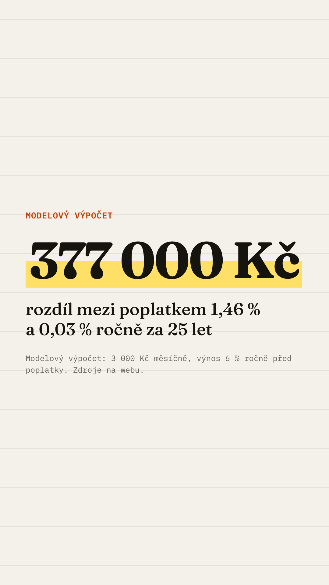

# Reklama A: „Poplatky“ → `/poplatky`

Čísla jsou z `src/data/examples.json` (3 000 Kč měsíčně, 25 let, výnos 6 % ročně před poplatky). Hlídá je test `ads/ads.test.ts`.

## Texty

- **Primární text:** Rozdíl mezi poplatkem 1,46 % a 0,03 % ročně? Za 25 let 377 000 Kč. Modelový výpočet, spočítejte si to na svých číslech.
- **Pokračování primárního textu:** Při 3 000 Kč měsíčně a výnosu 6 % ročně před poplatky. Stáhněte si srovnání 12 ETF z newyorské burzy: co z nich koupíte z Česka a jak je danit. Zdarma.
- **Titulek:** Kolik stojí poplatek 1,46 % ročně?
- **Popis:** Kalkulačka + tahák zdarma
- **Tlačítko:** Stáhnout

## Kreativa (text v obrázku)

- **Velké číslo:** 377 000 Kč
- **Řádek pod číslem:** rozdíl mezi poplatkem 1,46 % a 0,03 % ročně za 25 let
- **Drobně:** Modelový výpočet: 3 000 Kč měsíčně, výnos 6 % ročně před poplatky. Zdroje na webu.
- **Formáty:** feed 1080×1350, story 1080×1920 (horních a dolních ~250 px bez textu).

## Náhledy

- Feed 4:5: 
- Story 9:16: 

Znovu vygenerujete příkazem `npm run ads` (šablony v `ads/_src/`, texty z tohoto souboru).

## Odkazy (UTM)

- Feed: `https://etf-tahak.vercel.app/poplatky?utm_source=meta&utm_medium=paid_social&utm_campaign=etf_tahak_launch&utm_content=a_poplatky_feed`
- Story: `https://etf-tahak.vercel.app/poplatky?utm_source=meta&utm_medium=paid_social&utm_campaign=etf_tahak_launch&utm_content=a_poplatky_story`

## Návaznost na hero

Hero na `/poplatky` opakuje stejné číslo i stejnou větu (viz `src/content/hero.ts`):
„Rozdíl mezi poplatkem 1,46 % a 0,03 % ročně? Za 25 let 377 000 Kč.“ Pod ním je kalkulačka s volbou částky.

## Kontrola zásad Mety

- Žádné tvrzení o osobě adresáta („máte“, „jako investor“ ✗). Text mluví o poplatcích, ne o čtenáři.
- Žádný slib výnosu. Výnos 6 % je označený jako modelový předpoklad.
- Je uvedeno „modelový výpočet“.
- Žádné „bez rizika“, „zaručený“, „nejlepší“.
- K ověření před spuštěním: jestli Meta pro CZ vyžaduje Special Ad Category „Financial products and services“ a ověření inzerenta (omezí cílení).

## Nastavení kampaně (návrh)

- **Cíl kampaně:** provoz na web (Traffic, optimalizace na Landing page views). Konverzi Lead nastavte, až Pixel nasbírá první leady.
- **Cílení:** Česko, 24–45 let, všechna pohlaví, Instagram + Facebook, umístění feed a Stories/Reels. Zájmy: investování, ETF, akciové trhy, osobní finance. Žádné lookalike a úzké segmenty, dokud nebude Special Ad Category vyjasněná.
- **Special Ad Category:** „Financial products and services“ pravděpodobně omezí věk, lokalitu a zájmy. Ověřte při zakládání kampaně (neověřeno). Cílení výše pak platí jen v rozsahu, který Meta dovolí.
- **Rozpočet testu:** 2 sady × 500 Kč/den × 5 dní = 5 000 Kč. Rozdělení mezi A a B se dělá na úrovni reklamních sad, ať každá dostane stejný rozpočet.
- **Co měřit (PostHog + tabulka `leads`):**
  - v Metě: CTR na odkaz, CPC, počet kliků na odkaz,
  - na webu: `landing_viewed` proti klikům na odkaz (ztráta při načítání v in-app prohlížeči),
  - dál: engaged, `form_viewed`, `form_started`, `lead_created`,
  - výsledek: konverze a CPL podle `utm_content` (feed vs. story),
  - v rozpadu podle `in_app_browser`.
- **Vyhodnocení po 5 dnech:** pokračovat s kreativou a formátem s nižším CPL. Pod ~30 leady na sadu nejsou rozdíly průkazné, brát je jako směr, ne jako důkaz.
