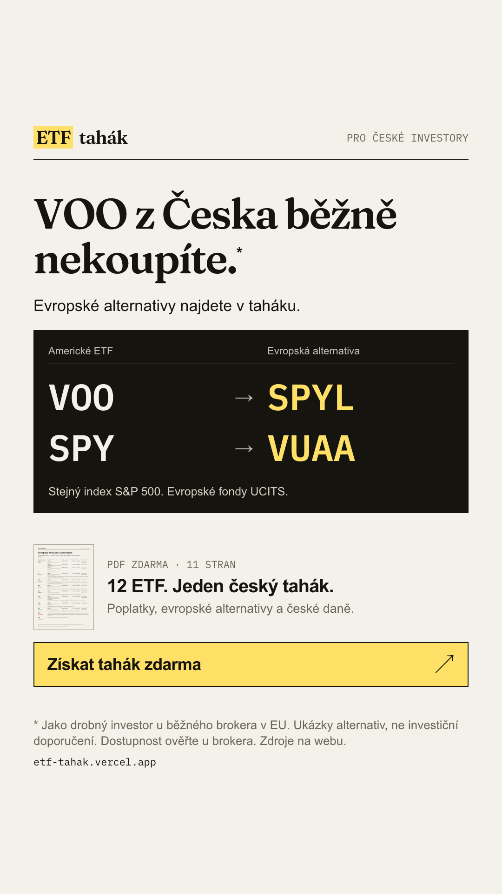

# Reklama B: „VOO z Česka nekoupíte“ → `/srovnani` (a `/`)

Čísla jsou z `src/data/etfs.json` (počty dvojčat). Hlídá je test `ads/ads.test.ts`.

## Texty

- **Primární text:** Drobní investoři v EU VOO u běžného brokera obvykle nekoupí. Srovnali jsme 12 ETF z NYSE a našli evropské alternativy.
- **Pokračování primárního textu:** U 4 z 12 existuje evropské dvojče se stejným indexem, u dalších 6 podobná alternativa. Zjistěte, v čem se liší, kolik stojí a jak se daní v Česku. Tahák má 11 stran a stáhnete ho hned po zadání e-mailu.
- **Titulek:** 12 ETF z NYSE: co koupíte z Česka
- **Popis:** Srovnání + tahák zdarma
- **Tlačítko:** Zjistit více

## Kreativa (text v obrázku)

- **Nadpis:** VOO z Česka běžně nekoupíte.
- **Podnadpis:** Evropské alternativy najdete v taháku.
- **Sloupec USA:** Americké ETF
- **Sloupec Evropa:** Evropská alternativa
- **Ukázka:** VOO → SPYL · SPY → VUAA
- **Poznámka srovnání:** Stejný index S&P 500. Evropské fondy UCITS.
- **Nabídka:** 12 ETF. Jeden český tahák.
- **Detail nabídky:** Poplatky, evropské alternativy a české daně.
- **Výzva:** Získat tahák zdarma
- **Drobně:** * Jako drobný investor u běžného brokera v EU. Ukázky alternativ, ne investiční doporučení. Dostupnost ověřte u brokera. Zdroje na webu.
- **Formáty:** feed 1080×1350, story 1080×1920; ve Stories je horních a dolních 270 px bez obsahu.

Ukázka ukazuje dvě konkrétní dvojice s přesnou shodou indexu, ne doporučené portfolio. Tickery se generují z ověřených listingů na Xetře. Miniatura je skutečná strana taháku. Záměr: doložit hodnotu ještě v reklamě a zároveň říct, že celý přehled je zdarma za e-mail. Nemícháme do jedné ukázky přesná dvojčata a pouze podobné fondy.

## Náhledy

- Feed 4:5: 
- Story 9:16: 

Znovu vygenerujete příkazem `npm run ads` (šablony v `ads/_src/`, texty z tohoto souboru).

## Odkazy (UTM)

- Feed: `https://etf-tahak.vercel.app/srovnani?utm_source=meta&utm_medium=paid_social&utm_campaign=etf_tahak_launch&utm_content=b_voo_feed`
- Story: `https://etf-tahak.vercel.app/srovnani?utm_source=meta&utm_medium=paid_social&utm_campaign=etf_tahak_launch&utm_content=b_voo_story`

## Návaznost na hero

Hero na `/srovnani` navazuje stejným problémem a nabízí celý přehled (viz `src/content/hero.ts`):
„VOO, SPY, VTI. Z Česka je běžně nekoupíte. Tady je, co místo nich.“ Pod ní je srovnání.

## Kontrola zásad Mety

- Žádné tvrzení o osobě adresáta. „Drobní investoři v EU“ je obecný popis regulace, ne oslovení.
- Žádný slib výnosu, žádný výnos v textu vůbec.
- Tvrzení „obvykle nekoupí“ je opatrné: vychází z praxe brokerů (viz `data/facts.source.yaml`, sekce priips), ne ze zákazu.
- Žádné „bez rizika“, „zaručený“, „nejlepší“.
- Special Ad Category: viz Nastavení kampaně níže (ověřeno).

## Nastavení kampaně (návrh)

- **Cíl kampaně:** provoz na web (Traffic, optimalizace na Landing page views). Konverzi Lead nastavte, až Pixel nasbírá první leady.
- **Cílení:** Česko, 24–45 let, všechna pohlaví, Instagram + Facebook, umístění feed a Stories/Reels. Zájmy: investování, ETF, akciové trhy, osobní finance. Žádné lookalike a úzké segmenty v prvním testu.
- **Special Ad Category (ověřeno 14. 10. 2026 v [dokumentaci Mety](https://developers.facebook.com/docs/marketing-api/audiences/special-ad-category)):** kategorie „Financial products and services“ je povinná pro inzerenty z USA nebo při cílení na USA. Pro „některé části Evropy“ platí jen u úvěrů, což tahák není. Pro CZ inzerenta s cílením na CZ tedy povinná není. Kdyby ji Meta při schvalování přesto vyžádala, cílení se zúží na 18–65+, všechna pohlaví, bez zájmů a lookalike. Kreativy i texty projdou i tak, změní se jen publikum.
- **Rozpočet testu:** 2 sady × 500 Kč/den × 5 dní = 5 000 Kč. Sady A a B mají stejný rozpočet, aby se CPL daly férově porovnat.
- **Co měřit (PostHog + tabulka `leads`):**
  - v Metě: CTR na odkaz, CPC, počet kliků na odkaz,
  - na webu: `landing_viewed` proti klikům na odkaz (ztráta při načítání v in-app prohlížeči),
  - dál: engaged, `form_viewed`, `form_started`, `lead_created`,
  - výsledek: konverze a CPL podle `utm_content` (feed vs. story),
  - v rozpadu podle `in_app_browser`.
- **Vyhodnocení po 5 dnech:** pokračovat s kreativou a formátem s nižším CPL. Pod ~30 leady na sadu nejsou rozdíly průkazné, brát je jako směr, ne jako důkaz.
