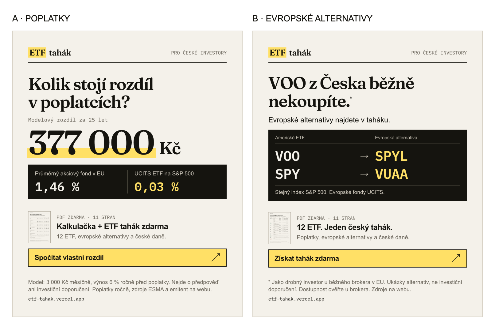

# Závěrečný audit zadání B

Datum: 15. 10. 2026. Audit a opravy: Codex. Výchozí revize: `bdd8f5d`.

## Verdikt

Projekt má hotové podstatné výstupy zadání B a po opravách je připravený k odevzdání. Není poctivé označit jej za bezchybný ani tvrdit, že jsou ověřené všechny podmínky pro libovolnou placenou kampaň. Zbývající provozní omezení jsou níže výslovně oddělená od splnění zadání.

Vizuální směr je soudržný: papír, serif, mono čísla a zvýrazňovač pokračují z reklam přes stránku do PDF. První obrazovka říká konkrétní nabídku a obsah je viditelný před formulářem. Funkční slabiny byly zejména ve skutečném dokončení cesty a přesnosti měření. Uživatel následně určil jako hlavní prioritu profesionálnější reklamy; obě sady proto dostaly novou kompozici a konkrétní ukázku hodnoty.

## Priorita: reklamy po přepracování

- **A – Poplatky:** otázka, modelový rozdíl 377 000 Kč, dvě konkrétní roční sazby a nabídka vlastní kalkulačky. V obrázku jsou podmínky výpočtu; neslibuje výnos.
- **B – Evropské alternativy:** problém dostupnosti VOO doplňuje skutečná ukázka VOO → SPYL a SPY → VUAA, v obou případech stejný index. Návštěvník dostane část odpovědi už v reklamě.
- **Obě:** značka ETF tahák, skutečný náhled PDF, počet stran, nabídka zdarma a výzva k akci. Výrazná typografie bez nakloněných razítek a bez imitací brokerů nebo smyšlených referencí.
- **Výstup:** čtyři PNG, 1080×1350 a 1080×1920 pro každý úhel. Kontrola na šířce odpovídající 375 px a vizuální kontrola obou Stories; obsah je uvnitř 270px bezpečných okrajů.
- **Kontrola pravdivosti:** částka, sazby a počet stran se načítají z dat, generátor odmítne neověřenou dvojici bez přesné shody indexu a Xetra listingu. Copy včetně informace o zadání e-mailu je v obou `copy.md`.

Jde o připravené kreativy a návrh kampaně. Vyšší konverzi nebo schválení reklam nedokládá samotný vizuální návrh; to ukáže až reálný test.

## Kontrola proti zadání

| Požadavek | Důkaz v projektu / ověření | Výsledek |
|---|---|---|
| Český drobný investor z mobilní reklamy | Persona a kontext v README §2; čeština, CZK a české daně | Splněno |
| Srovnání ETF z NYSE | 12 fondů s listingem NYSE Arca, zdrojové YAML a emitenti; navíc přesná a podobná evropská alternativa jsou odlišené | Splněno, dvě dividendové hodnoty zůstávají označené jako neověřené |
| Hodnota před kontaktem | Výsledek kalkulačky, tři celé karty, evropské alternativy a tři náhledy skutečných stran PDF | Splněno |
| Nabídka a okamžik žádosti | PDF + odemčené srovnání; hlavní formulář pod osobním výsledkem; zdůvodnění v README §3–7 | Splněno |
| Co nejméně polí | Jediné viditelné pole e-mail, návrhy oprav domény; ostatní otázka až po odeslání a dobrovolně | Splněno |
| Interakce vedou ke kontaktu | Kalkulačka → formulář, filtry → brána, hero a sticky → dialog | Splněno; průchod přes bránu opraven |
| Co dostane po odeslání | Stažení 11stránkového PDF, odemčení bez reloadu; e-mail se v této konfiguraci neslibuje | Splněno |
| Dvě reklamy a návaznost hero | A poplatky → `/poplatky`; B dostupnost → `/srovnani`; texty, UTM, feed a Stories v `ads/` | Splněno |
| Skutečná data a zdroje | Zdroje a data u hodnot, odkazy na emitenty, ČNB, ESMA a zákon; datový build a 21 testů | Splněno v uvedeném rozsahu; nejde o nezávislou certifikaci všech hodnot |
| Měření celé cesty | Typované události, klientský funnel, nový kontakt na serveru, UTM a cesta v DB; testy obou variant i brány | Splněno; omezení blokování analytiky je přiznané |
| README: pořadí, konverze, tři hypotézy podle dopadu | §5, §10 a §11; odhad 9 % je označený jako předpoklad, ne naměřený výsledek | Splněno |
| README: práce s AI, kontrola, chyby a rozhodnutí | §14–15, původní pravidla v `CLAUDE.md`, plán a exporty | Splněno; audit doplněn odděleně |
| Veřejný GitHub a průběžná historie | [kovy88/etf-tahak](https://github.com/kovy88/etf-tahak), PUBLIC; před auditem 90 commitů, historie zachovaná | Splněno |
| Veřejný hosting | [etf-tahak.vercel.app](https://etf-tahak.vercel.app), produkční Git deploy z `main` | Splněno |
| `ai-log/` | Původní exporty Claude Code v `00–10`; auditní chat Codex je samostatný `11-codex-audit.md` | Splněno |
| Odeslání řešení do 16. 10. 2026 | Připravené veřejné odkazy; e-mail odesílá uchazeč | Zbývá odeslat, není součástí automatického auditu |

## Co audit skutečně opravil

| Slabina | Dopad a oprava | Ověření |
|---|---|---|
| Brána po úspěšném odeslání odstranila vlastní formulář včetně poděkování | Chybělo PDF na místě odeslání, dobrovolná otázka a `thankyou_viewed`. Stabilní slot nyní zůstane před odemčenými kartami a stáhnutí je vidět | Nový krok E2E nejprve selhal na původním kódu, po opravě prochází |
| Duplicita posílala `lead_created` | Nafukovala nové kontakty v analytice. Server nyní událost posílá jen po novém vložení; veřejná odpověď stále neprozradí existenci adresy | Serverový test duplicity |
| Rychlé odeslání před lazy importem PostHogu nemělo společnou identitu | Serverový lead se nemusel spojit se začátkem funnelu. ID se připraví předem a předá do inicializace SDK | Dva unit testy, běžná návštěva zachová identitu spravovanou SDK |
| Dlouhé sekce nepřekročily pevný práh IntersectionObserveru | Pomalé odrolování do srovnání mohlo chybět v cestě návštěvníka. Viditelná výška se měří po snímcích, jednou pro každou sekci | Regresní E2E nejprve selhal, nyní prochází |
| Chyby UPDATE Supabase se ignorovaly | Profil a odhlášení tvrdily úspěch i při chybě DB. API kontroluje `error`; otázka umožní opakování, odhlášení má chybovou stránku | Serverové testy a E2E opakování odpovědi |
| Zápis do sessionStorage mohl selhat, zatímco čtení fungovalo | Následné čtení smazalo výsledek z paměti a návštěvník přišel o odemčení. Při chybě zápisu zůstává stav v paměti | Unit test kvóty a E2E s `QuotaExceededError` |
| Síťový požadavek neměl konečný timeout | Formulář mohl zůstat na „Odesílám“. Limit 10 s zachová stávající fallback s dostupným PDF | Kontrola implementace, existující E2E pro serverový fallback; mobilní síť nebyla laboratorně měřena |
| Null MX byl považován za funkční poštovní doménu | Doména výslovně odmítající poštu prošla kontrolou kontaktu. Explicitní Null MX se nyní odmítá | Tři DNS unit testy |
| Pád analytiky zastavil navazující e-mail | Chyba měření už neblokuje doručení | Serverový test výpadku analytiky |
| Fakta mimo ETF obcházela validaci při chybějícím `as_of` | Build nyní vyžaduje zdroj a datum také v `facts.source.yaml` | Dva negativní Python testy |
| PDF zjednodušovalo povinnost podání přiznání na hranici 50 000 Kč | Doplněna zaměstnanecká hranice jiných příjmů 20 000 Kč a podmínky podle § 38g odst. 2 | Finanční správa + zákon, nový PDF render, vizuální kontrola strany 7 |
| Generátor mazal starší hashované PDF | Dříve uložené odkazy mohly přestat fungovat. Starší verze nyní zůstávají dostupné | Kontrola starého i nového souboru |
| Texty a README nadsazovaly jistotu | Odstraněn nepodložený žebříček „nejpopulárnějších“, opraven provozovatel v README, rozlišené měření bez cookies a spojení návštěvy s kontaktem | Kontrola textů a dokumentace |
| H3 měla jiný jmenovatel než výpočet vzorku | Primární metrika je nyní konverze celé stránky stejně jako v kalkulaci vzorku; CTA neslibuje vypnutý e-mail | README §11 a `analytics/sample_size.py` |

## Výsledky ověření

- `npm test`: **95 / 95**, včetně samostatné hodnoty reklam a skutečných dvojic v kreativě B.
- `npx playwright test`: **42 / 42**, obě varianty, 320–414 px, krajina, dialog, cookies, kalkulačka, brána, PDF a selhání úložiště.
- `cd data && uv run pytest`: **21 / 21**, `uv run ruff check` bez nálezů.
- `npm run lint`, `npx tsc --noEmit`, `npm run build`, `git diff --check`: úspěch.
- `node scripts/check-bundle.mjs`: tajné serverové klíče ani jejich hodnoty nejsou v klientském bundlu. Kontrola aktuálně nakonfigurovaných tajných hodnot proti sledovaným souborům a celé Git historii také bez nálezu.
- PDF: **11 stran A4, 495 117 B**; generátor kontroluje přetečení každé strany. Doplněný daňový odstavec na straně 7 je vizuálně ověřený.
- ČNB: všechny čtyři archivované kurzovní lístky (2016, 2021, 2025, 2026) odpovídají aktuálně staženým primárním souborům.
- ESMA: ověřena tabulka MR-CP.4, hodnota **1,46 %** v řádku průběžných nákladů za desetiletý horizont pro rok 2024. Nejde o odhad nákladů konkrétního českého fondu.
- Vercel Firewall: pravidlo na `POST /api/lead*` je live, limit 10 požadavků / 60 s / IP, blokace 5 minut, žádný nepublikovaný draft. Neověřovalo se záměrným zahlcením veřejného formuláře.
- Lighthouse mobil na nasazených opravách: A **98 / 100 / 100 / 100**, B **100 / 100 / 100 / 100** (výkon / přístupnost / best practices / SEO), LCP **1,4 s**, CLS **0,001 / 0**. Jde o jedno laboratorní měření pro každou URL, ne terénní statistiku.
- Skutečný produkční průchod na revizi `5294881`: vložení kontaktu přes bránu bez mocku, UTM a cesta v DB, PDF viditelné na místě odeslání, uložení dobrovolné odpovědi, jedna DB řádka po duplicitě, odhlášení a odmítnutí Null MX. Staré i nové PDF vrací 200. Klientské události skutečně odcházely do PostHogu a `landing_viewed` měl stejný identifikátor jako uložený kontakt. Bez chyby JavaScriptu; e-mail se neposlal. Vlastní jednorázový auditní kontakt byl po kontrole smazán. Stručný záznam je v [`audit-evidence.json`](audit-evidence.json).

Při testu přenosu analytiky bylo potřeba emulovat běžný mobil včetně User-Agent Client Hints. Produkční PostHog správně filtruje HeadlessChrome i `navigator.webdriver`; pouhá změna User-Agentu proto nestačila. Produkční ochrana proti botům se kvůli testu nevypínala. Ověřen byl odchozí přenos klientských událostí a společná identita; dashboard PostHogu nebyl nezávisle načten přes administrační API.

Úplná E2E sada jednou skončila dvěma timeouty při souběžném běhu lokálních kontrol. Oba případy samostatně prošly s trace a následná celá sada prošla 42/42. Žádné zvýšení timeoutů ani zapnutí retries chybu nezakrývá. Ignorování výstupních adresářů v ESLintu navíc odstranilo kolizi s mazáním `test-results` při startu Playwrightu.

## Zdroje namátkové věcné kontroly

- [ESMA, report publikovaný 3. 3. 2026, tabulka MR-CP.4](https://www.esma.europa.eu/sites/default/files/2026-03/ESMA50-1949966494-4065_Market_Report_-_Costs_and_Performance_of_EU_Retail_Investment_Products.pdf).
- [Finanční správa: obecné informace pro fyzické osoby, hranice podání přiznání](https://financnisprava.gov.cz/cs/dane/dane/dan-z-prijmu/fyzicke-osoby/obecne-informace).
- [Zákon o daních z příjmů, § 38g](https://www.zakonyprolidi.cz/cs/1992-586#p38g).
- ČNB: přesné denní URL a archivy v `data/raw/cnb/`, metodika v `data/build.py`.

Kontrola zdrojů byla namátková. Dynamická stránka Vanguardu nevrátila přes webový extraktor čitelná data, proto audit netvrdí nové nezávislé potvrzení všech hodnot emitentů. Jejich původní zdroje, data a výhrady zůstávají zachované.

## Co zůstává před skutečnou kampaní

1. **E-mail je vypnutý**, dokud není vlastní ověřená odesílací doména. Nabídka tím není porušená: návštěvník dostává PDF hned. Automatická dlouhodobá komunikace není spuštěná.
2. **Meta Pixel nemá ID.** Cestu měří PostHog a databáze. Pro optimalizaci kampaně na Meta Lead je potřeba doplnit účet, ID a ověřit přijaté události. Pixel navíc měří přijatá odeslání, zatímco nové kontakty deduplikuje server a DB.
3. **Android a Facebook/Messenger je potřeba projít ručně.** Automatická emulace nenahrazuje skutečnou klávesnici a chování stahování v in-app prohlížeči. Původní ruční kontrola Instagramu na iPhonu je zaznamenaná v README.
4. **Propagační sekvence zadavatele vyžaduje konkrétní účel a odpovídající souhlas.** Převzetí provozu, správce údajů a odesílání nabídek se musí vyřešit před takovým použitím kontaktů. Tento audit není právní stanovisko.
5. **Data s označením neověřeno zůstávají přiznaná.** Jde zejména o dividendový výnos VWO a SPY a ověření konečného legislativního stavu Retail Investment Strategy. Audit tyto položky nepřeznačil na ověřené.
6. **A/B hypotézy jsou návrh**, skutečný randomizovaný split ještě neběží. Zadání žádá návrhy; dva reklamní úhly už mají své URL a UTM. Odhad konverze není výsledkem placeného provozu.

Pro odevzdání použijte [veřejný repozitář](https://github.com/kovy88/etf-tahak) a [veřejnou stránku](https://etf-tahak.vercel.app). Nákup domény, aktivace reklam ani odeslání přijímacího e-mailu v rámci auditu neproběhly.
